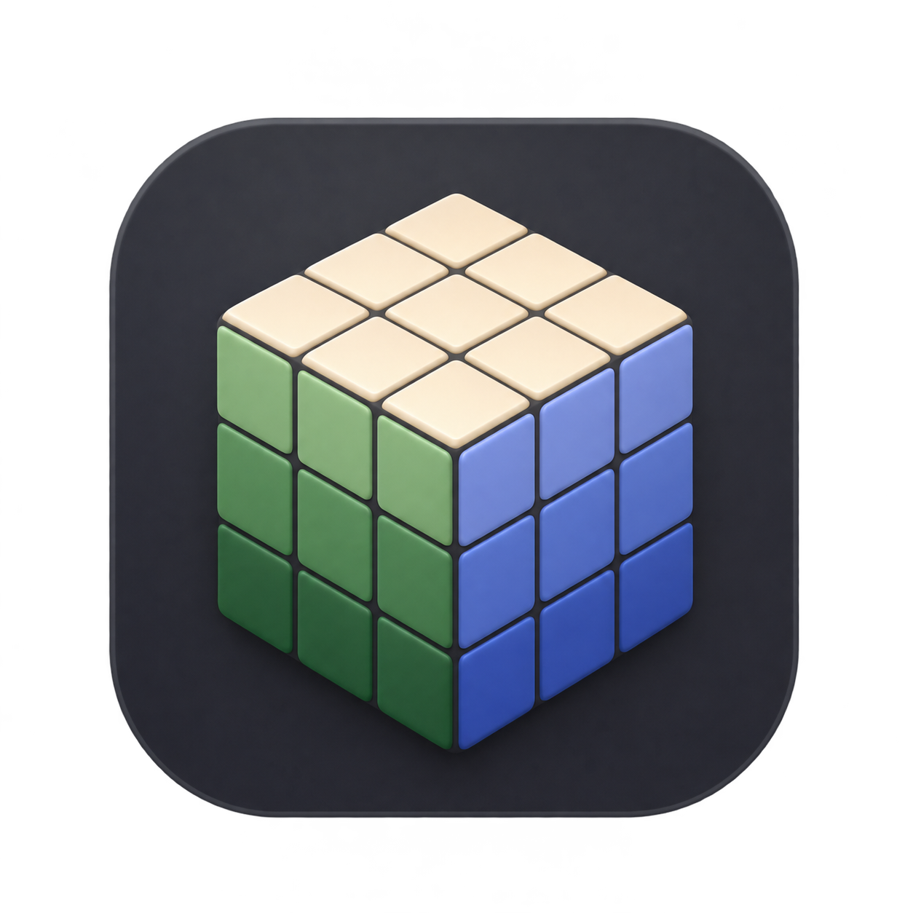
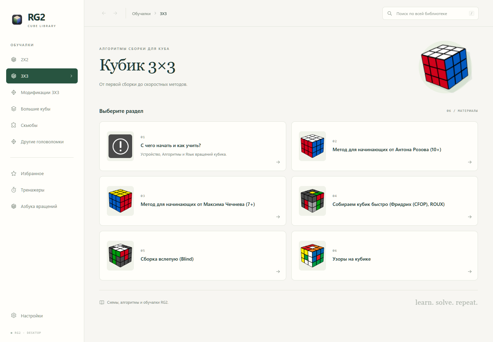
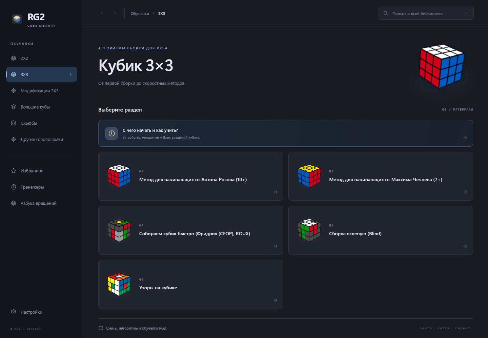

# RG2 · Desktop

Десктопное приложение для Windows с алгоритмами сборки кубиков и других головоломок. Материалы, формулы, схемы и порядок разделов перенесены из RG2F 4.241017.6; библиотека работает без интернета.

[Скачать приложение для Windows](https://github.com/pro-007-m/rg2-desktop/releases/latest)

## Возможности

- Исходные разделы для 2×2, 3×3, больших кубов, модификаций 3×3, скьюбов и других головоломок.
- Темы **Atelier** и **Graphite**. По умолчанию — **«Как в системе»**, с переключением вслед за темой Windows.
- Поиск по названиям, формулам и тексту; избранное; история переходов; увеличение схем.
- Формулы в отдельных блоках с копированием. Кнопка «Выделить» увеличивает выбранный алгоритм, а остальные варианты на странице делает компактнее; выбор сохраняется отдельно для каждой страницы.
- Таймер с сессиями, предварительным осмотром, штрафами +2/DNF и средними ao5/ao12.
- Генератор скрамблов 2×2–7×7, тренажёры PLL и азбуки для слепой сборки.
- Азбука вращений: 11 групп и 212 исходных схем с обозначениями.
- Решатель 3×3 по раскраске: CROSS → F2L → OLL/COLL → PLL, вращающаяся 3D-модель, все применимые формулы базы, пошаговое проигрывание и выбор другого продолжения.
- Настройки, избранное и результаты сохраняются локально. Видеоуроки открываются в браузере по исходным ссылкам.

| Atelier | Graphite |
| --- | --- |
|  |  |

## Запуск

Распакуйте архив из [Releases](https://github.com/pro-007-m/rg2-desktop/releases/latest) и откройте `RG2.Desktop.exe`. Сохраните папку `data` и остальные файлы рядом с программой.

Требуются Windows x64, [.NET Desktop Runtime 10](https://dotnet.microsoft.com/download/dotnet/10.0) и [Microsoft Edge WebView2 Runtime](https://developer.microsoft.com/microsoft-edge/webview2/).

## Сборка

Установите .NET SDK 10 и выполните в корне репозитория:

```powershell
dotnet restore --locked-mode
dotnet publish RG2.Desktop.csproj -c Release -r win-x64 --self-contained false -o publish
```

Готовая программа появится в `publish/`. Чтобы включить .NET Runtime в сборку, замените `--self-contained false` на `--self-contained true`.

## Проверки

Для проверки данных нужен Python 3, для вычислений и форматирования алгоритмов — Node.js 22 или новее и npm. jsdom используется только в тестах и не входит в приложение:

```powershell
python tests/catalog.test.py
npm ci
npm test
```

Проверки сверяют исходные ресурсы по SHA-256, полноту материалов, пути к схемам, обозначения вращений, скрамблы, штрафы и средние результаты, повороты куба и буквенные соответствия. Дополнительно вся библиотека проверяется на сохранность текста, формул, ссылок и изображений после выделения алгоритмов; проверяются копирование, переключение выделения и сохранение выбора.

## Структура

- `MainWindow.xaml.cs` — окно Windows, WebView2, системная тема и открытие внешних ссылок.
- `data/index.html`, `styles.css`, `app.js` — интерфейс и навигация.
- `data/algorithms.js`, `algorithms.css` — извлечение формул в отдельные блоки, кнопки копирования и оформление выбранного алгоритма.
- `data/tools.js` — таймер, скрамблы и тренажёры.
- `data/solver/` — автономный решатель, точная математика куба, поиск, локальная база алгоритмов и Three.js 0.187.0 с лицензией MIT.
- `data/catalog.json`, `trainer-data.json`, `assets/` — материалы и исходные ресурсы.
- `data/migration-report.json` и файлы с исходными строками/массивами — проверяемые сведения о переносе.

## Решатель CFOP + COLL

Откройте **Тренажёры → Решатель CFOP + COLL**, перенесите цвета на развёртку или 3D-модель и нажмите «Проверить и найти решение». Куб проверяется на количество цветов, набор деталей, ориентации и чётность перестановок. Направления U/R/F/D/L/B подписаны на развёртке; камеру можно вращать мышью.

По умолчанию рекомендованные варианты проигрываются автоматически. Отдельная настройка **«Пауза перед выбором алгоритма»** останавливает решение на границах этапов. «Пауза», «← Ход» и «Ход →» управляют отдельными ходами. Выбор другой формулы возвращает куб к началу соответствующего этапа и пересчитывает продолжение. Все выполняемые ходы, включая повороты куба и AUF, появляются над моделью.

Для креста точная таблица охватывает 190 080 состояний четырёх рёбер и доказывает минимальную длину в HTM. Рекомендация также учитывает продолжение F2L. Поиск F2L сравнивает порядок пар и вставки, сохраняя ранее собранные детали на границах этапов. Для последней пары учитывается фактическое продолжение OLL/COLL и PLL. Это ограниченный поиск удобных решений; глобальная минимальность всего CFOP и скорость исполнения конкретным человеком не гарантируются. Скорость анимации меняет только проигрывание.

### Обновление 1.2.0

Панель 3D-модели стала выше и занимает общую высоту с панелью вариантов. Обе панели прокручиваются вместе со страницей, а раскраска куба расположена сразу под их общим нижним краем. Кнопка **«К виду ходов»** находится рядом с управлением проигрыванием и возвращает удобный ракурс камеры, сохраняя раскраску и историю ходов. Во время проигрывания текущий ход остаётся видимым внутри строки нотации; положение страницы сохраняется.

Яркие цвета наклеек в стиле GAN одинаково выглядят на всех гранях модели, развёртке и палитре. Освещение корпуса сохраняет объём куба. Минимальный размер подписей в решателе — 12 px.

Кнопка **«Новый скрамбл»** каждый раз загружает новое перемешивание из 20 обычных ходов U/R/F/D/L/B. Рядом отображаются отдельная запись, кнопка **«Копировать скрамбл»** и ориентир цветов U/F. Чтобы повторить позицию на физическом кубике, начните с собранного куба, поверните его указанными цветами вверх и вперёд и выполните показанные ходы. Основа перемешивания использует цвета центров текущей раскраски, в том числе изменённую цветовую схему.

Запись скрамбла сохраняется во время решения и при нажатии **«Сначала»**. Ручное изменение наклеек, очистка или загрузка собранного куба удаляют её. После перезапуска приложения запись восстанавливается при совпадении с сохранённой раскраской. Генерация загружает позицию; поиск решения запускается отдельной кнопкой.

В настройках доступны версия приложения, оформление, горячие клавиши и сведения о локальном хранении данных.

COLL предлагается при ориентированных рёбрах верхнего слоя. Отдельная опция «Подготовка к COLL» добавляет конечную библиотеку EOLL-подготовок и маршрут EOLL → COLL → EPLL. Сравнение OLL и COLL учитывает стоимость следующего PLL, а не только длину первой формулы. Для креста можно выбрать любой цвет или сравнить все шесть.

Все применимые проверенные варианты импортированной базы доступны через «Показать ещё варианты». Сгенерированные варианты CROSS/F2L ограничены явно показанной областью и бюджетом; «Продолжить поиск» расширяет их. Математически всех алгоритмов бесконечно много. Записи, которые не проходят разбор и проверку эффекта, исключаются из предложений.

Импортированы формулы из RG2 и всех доступных списков альтернатив SpeedCubeDB: 41 случай F2L, 57 OLL, 40 COLL и 21 PLL. Ссылки и хэши полученных страниц находятся в [реестре источников](docs/solver-sources.json). Импорт воспроизводится скриптом `tools/import-solver-algorithms.py`; приложение работает с локальным снимком и не обращается к интернету во время сборки.
